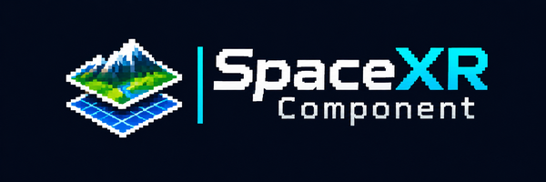

# @spacexr/dem

Renderer-neutral digital elevation models. A height grid is a one-channel raster of [`@spacexr/raster`](https://github.com/pandaGaume/3d-tiles-core/tree/main/node/packages/raster), so DEM tiles are sampled, stitched and cached like any other raster; this package adds the elevation encodings, decoding off the rendering thread, statistics, normals, the Mapzen Terrarium preset and continuous surfaces over several levels of detail.

## Install

```bash
npm install @spacexr/dem
```

## Load a Mapzen Terrarium elevation tile

```ts
import { WorkerDemDecoder, createMapzenTerrariumSource, loadDemTile } from "@spacexr/dem";

const dem = createMapzenTerrariumSource();
const decoder = new WorkerDemDecoder([new Worker(new URL("./dem-decoder.worker.ts", import.meta.url), { type: "module" })]);
const tile = await loadDemTile(dem, { lod: 12, x: 1205, y: 1402 }, decoder, { normals: true, signal });

if (tile?.content) {
    const { minimum, maximum, mean, highest, quadrants } = tile.content;
    const northWest = tile.content.view(0, 0, 128, 128);
}
```

`loadDemTile` returns `undefined` when the tile does not exist. `DemInfos` statistics ignore missing samples. Display `dem.source.attribution` with the data.

## Continuous surfaces

`DemPyramid` is a raster pyramid of height grids. Each DEM tile loads with its east, south and south-east neighbours and is stitched with them, so that neighbouring tiles share their edge heights; tiles beyond `maxLOD` sample a sub-area of their ancestor.

```ts
import { ChildHeightRanges, DemPyramid, selectSurfaceLevels, webDemTileLoader, webMercatorSurfaceNormal } from "@spacexr/dem";

const childHeightRanges = new ChildHeightRanges();
const pyramid = new DemPyramid({ load: webDemTileLoader(dem, decoder), maxLOD: 15, wrapX: true, childHeightRanges });

const heights = await pyramid.tileHeights({ lod: 17, x: 67000, y: 45000 });
const height = heights?.sampler(0.5, 0.5); // u east, v south over the tile
const bounds = childHeightRanges.rangeFor({ lod: 18, x: 134000, y: 90000 }); // prepared from the parent DEM

// A point on the edge between tiles of levels 16 and 17, x east and y south over the pyramid.
const levels = selectSurfaceLevels([16, 17], "coarsest");
const surface = pyramid.surfaceHeight(x, y, levels);
const gradient = pyramid.surfaceGradient(x, y, levels, 16); // one step per cell of a 16-cell grid
const normal = gradient && webMercatorSurfaceNormal(gradient, up, verticalScale);
```

## Decoding off the rendering thread

Decoding one 256 px PNG tile takes about 60 ms in a browser, which would stall rendering if it ran on the main thread. DEM tiles therefore go through the `IDemDecoder` port:

- `WorkerDemDecoder` sends each tile to the least busy worker of a pool. The tile bytes are transferred to the worker and the heights are transferred back, so neither is copied. Aborting a request settles it immediately.
- `installDemDecoderWorker(self)` serves those requests inside the worker. The package does not create workers itself, because each bundler has its own worker syntax; the application provides a one-line worker module:

```ts
// dem-decoder.worker.ts
import { installDemDecoderWorker } from "@spacexr/dem";
installDemDecoderWorker(self);
```

- `LocalDemDecoder` decodes on the calling thread, for tests, Node.js or code already running in a worker.

Image bytes become pixels through the `IImageDecoder` port of `@spacexr/raster`.

See the repository document `docs/dem.md` for the cross-language rules.

## License

Apache-2.0.
